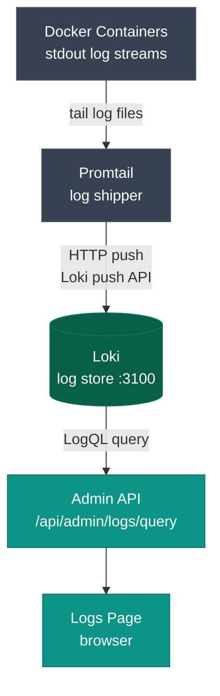

**Route:** `/admin/logs`

Live container log viewer backed by Loki. Shows real-time stdout from any Docker container on the server.

---

## How to use

1. **Select containers** — click the container chip(s) at the top to choose which Docker containers to show logs for. Only containers that have sent at least one log line to Loki appear in the list.

2. **Search** — type in the search box to filter log lines. The search term is sent as a LogQL filter to Loki (case-insensitive substring match).

3. **Level filter** — filter by log level: `info`, `warn`, `error`, `debug`. Not all services emit structured log levels.

4. **Time range** — choose `15m`, `1h`, `6h`, or `24h` from the dropdown. Logs for the selected window are loaded and then auto-refreshed every few seconds.

5. **Auto-refresh** — the logs panel polls every few seconds while it's open, so you see new log lines without manually refreshing.

---

## Container access control per user

Admin-role users see all containers. Non-admin (viewer-role) users only see containers in their `allowed_containers` list.

To restrict a user's container access:
1. Go to **Settings → Users**.
2. Edit the user and set **Allowed Containers** to a JSON array of container names, e.g. `["n8n", "media-api"]`.
3. Save. The user will only see those containers in the log viewer.

Leave **Allowed Containers** blank (null) for unrestricted access — only appropriate for admin-role users.

---

## Data pipeline

**Promtail** collects stdout from all containers on the server and pushes it to **Loki**. In multi-server mode, worker Promtail instances push to the same central Loki on the main server — so you can view all server logs from one place.

---

## API endpoints

| Method | Path | Params | Description |
|---|---|---|---|
| `GET` | `/api/admin/logs/labels` | — | List container names available in Loki |
| `GET` | `/api/admin/logs/query` | `containers`, `search`, `level`, `range` | Fetch log lines |
| `GET` | `/api/admin/logs/stats` | `containers`, `range` | Log volume chart data |
