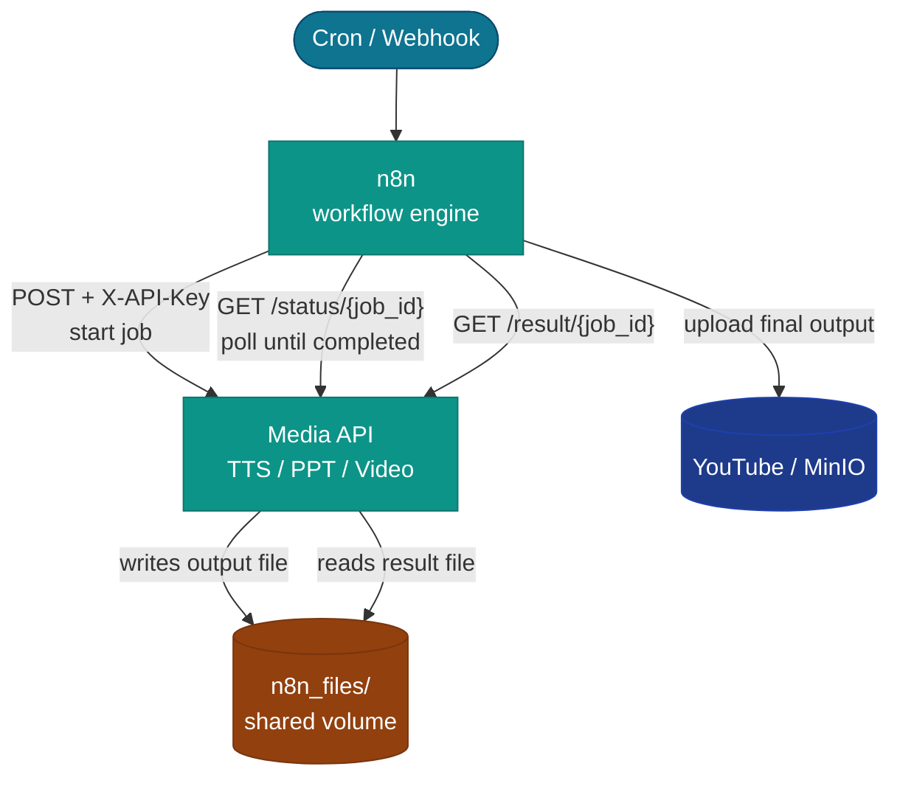
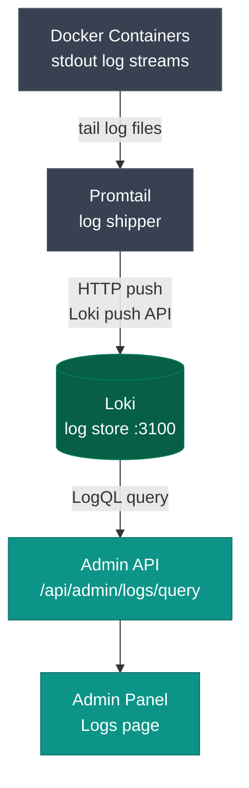
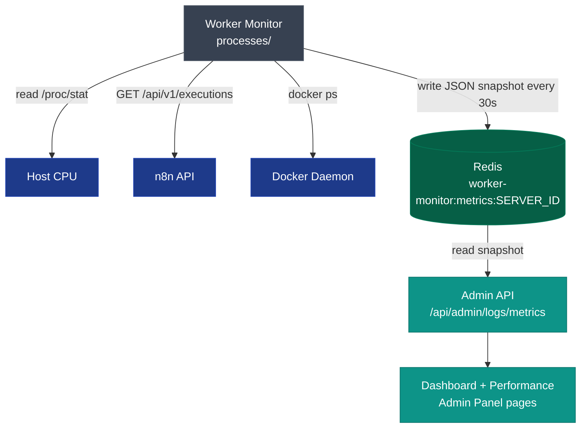
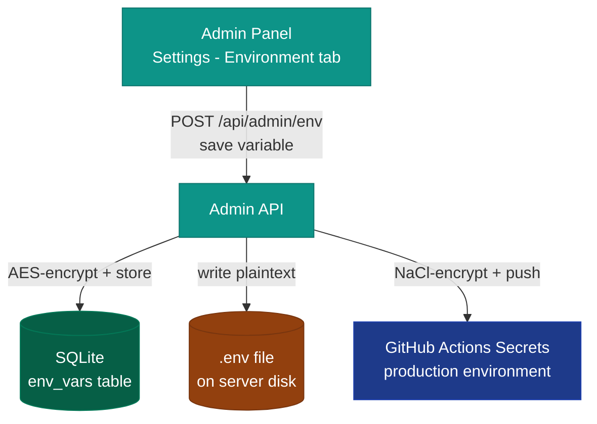
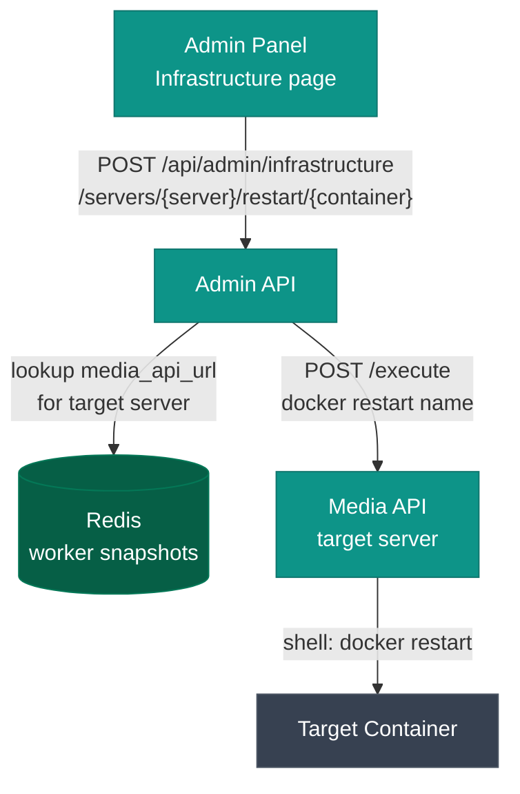

## Workflow execution (happy path)

A scheduled cron trigger kicks off the pipeline. n8n calls the Media API for heavy work; the workflow polls until complete, then retrieves the result file.

**Key detail:** The `n8n_files/` volume is shared between `media-api` and `n8n`. When the Media API writes an audio or video file, n8n can read it directly using the shared volume mount — no file transfer over HTTP needed for large files.

---

## Log pipeline

Container stdout is collected by Promtail, pushed to Loki, and queried by the Admin API when the Logs page is open.

**Promtail config:** Promtail runs on each server (main and workers) and ships logs for all containers on that server. In multi-server mode, worker Promtail instances push to the same central Loki instance on the main server.

---

## Worker health monitoring

`worker-monitor` runs as a lightweight Python daemon, polling system state every 30 seconds and writing a JSON snapshot to Redis. The Admin API reads these snapshots to populate the Dashboard and Performance pages.

**Multi-server:** Each server runs its own `worker-monitor` writing to `worker-monitor:metrics:<SERVER_ID>`. The Admin API reads all keys matching that prefix and aggregates them into a per-server selector on the Performance page.

---

## Environment variable write flow

When you save a variable through the Admin Panel → Settings → Environment tab:

Changes to `.env` take effect on the next container restart. The admin panel writes the file but does not automatically restart services.

---

## Container restart flow (via Admin Panel)

This is how the Admin Panel restarts containers without SSH. The `media_api_url` field in the worker-monitor Redis snapshot tells the admin-api which server's media-api to call for each server.
