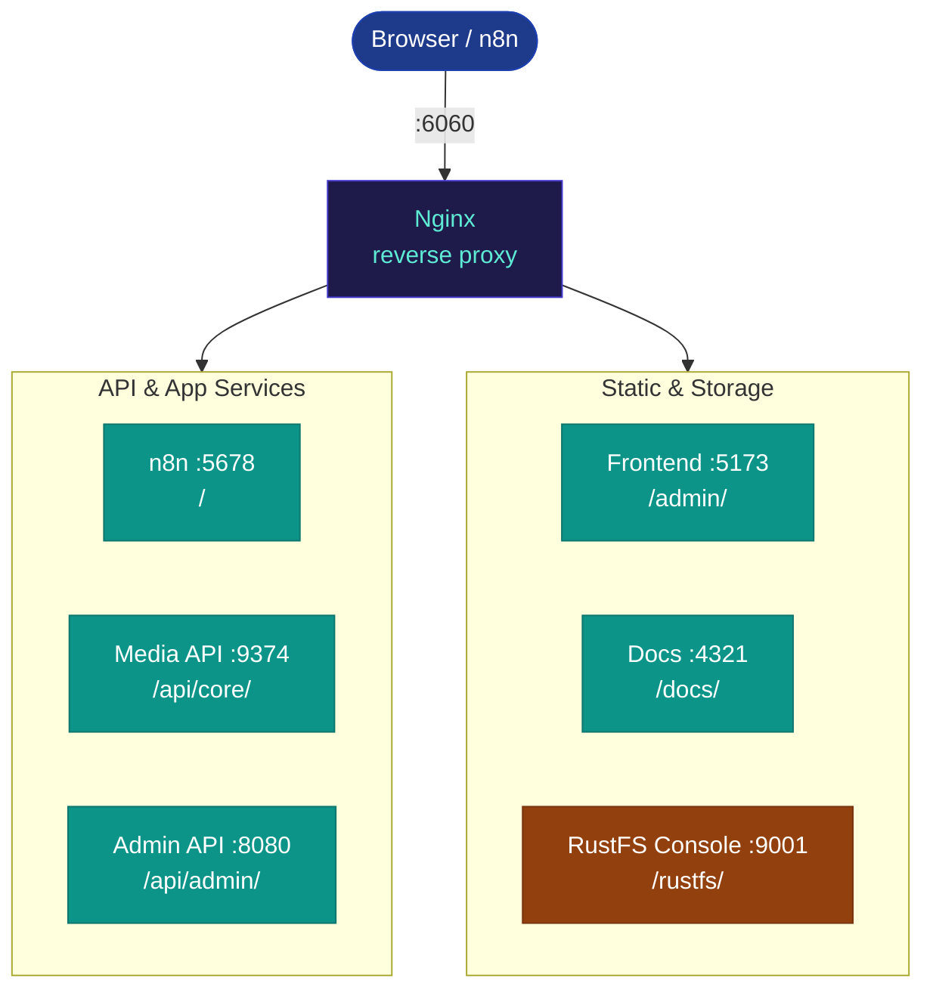

Nginx is the single entry point for all traffic. It listens on port **6060** inside Docker (exposed to the host as `6060:6060` in dev; mapped to 80/443 by aaPanel in production).

## Path routing



| External path | Upstream | Notes |
|---|---|---|
| `/` | `n8n:5678` | WebSocket upgrade enabled; 2-hour proxy timeouts for long-running executions |
| `/api/core/` | `media-api:9374` | WebSocket upgrade enabled (for `/ws/voice-chat`) |
| `/api/admin/` | `admin-api:8080` | Standard HTTP proxy; trailing slash stripped |
| `/admin/` | `frontend:5173` (dev) | Vite HMR in dev; static build in prod served by admin-api |
| `/rustfs/` | `rustfs:9001` | No rewriting — the MinIO-specific `sub_filter` rules were removed since they don't apply to RustFS's console (unverified whether the console needs any rewriting at all) |

## Headers forwarded to all upstreams

| Header | Value | Purpose |
|---|---|---|
| `X-Real-IP` | Original client IP | Rate limiting, audit logging |
| `X-Forwarded-For` | Original client IP chain | Audit log IP address |
| `X-Forwarded-Proto` | `https` | Tells services they're behind TLS even on internal HTTP |
| `Upgrade` | passthrough | Required for WebSocket connections |
| `Connection` | see below | Required for WebSocket connections |

## WebSocket handling

The `map $http_upgrade $connection_upgrade` block at the top of `nginx.conf` sets:

- `Connection: upgrade` — when the client sends `Upgrade: websocket`
- `Connection: close` — otherwise

This is what makes both n8n's live execution UI (WebSocket to `:5678`) and the `/ws/voice-chat` endpoint (WebSocket to `/api/core/ws/voice-chat`) work through the proxy.

Without this map, WebSocket upgrade requests would fail silently and connections would fall back to HTTP.

## Proxy timeouts

For the n8n upstream, timeouts are set to 2 hours:

```
proxy_read_timeout 7200s;
proxy_send_timeout 7200s;
```

This is necessary because some n8n workflows (video pipeline, large batch jobs) run for extended periods and the connection must stay open while the client watches execution progress.

## RustFS console routing

The service (compose name `rustfs`, proxied at `/rustfs/`) runs [RustFS](https://rustfs.com), not MinIO — MinIO's Docker images were pulled from both Docker Hub and Quay.io in September 2026, so the stack was migrated to RustFS as a drop-in S3-API-compatible replacement. The S3 API itself (what the Media API actually talks to) is unaffected by this.

The old MinIO console had a `sub_filter`-based rewriting block here (MinIO's web UI generates internal links with absolute paths, so responses had `/` rewritten to `/minio/` in href/src attributes). That rewriting was specific to MinIO's web app and doesn't apply to RustFS's console, so it's been removed rather than carried over unverified. Whether RustFS's console needs its own rewriting (or none at all) under a subpath hasn't been tested — check `http://localhost:6060/rustfs` directly before relying on it.
