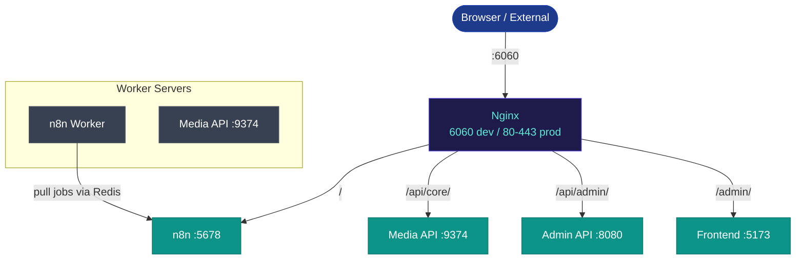
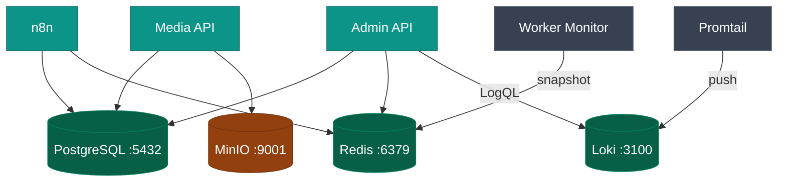

The platform is a collection of Docker containers sitting behind a single Nginx reverse proxy. All external traffic (browser, webhook calls, API calls) enters on one port and Nginx routes it to the right service.

## Traffic flow

## Data stores

## Service roles at a glance

| Service | Container | Role |
|---|---|---|
| **n8n** | `n8n` | Workflow automation engine. Executes all workflows. |
| **Media API** | `media-api` | FastAPI for CPU-intensive media work (TTS, video, PPT). |
| **Admin API** | `admin-api` | Operations panel backend (env vars, logs, health, backups). |
| **Frontend** | `frontend` (dev) | React SPA served by Vite in dev; static files in prod. |
| **Worker Monitor** | `worker-monitor` | Polls CPU/containers/executions; writes snapshots to Redis. |
| **PostgreSQL** | `postgres` | Primary database for n8n and Media API. |
| **Redis** | `redis` | n8n job queue (multi-server) + worker-monitor snapshots. |
| **RustFS** | `rustfs` | Object storage for video files. |
| **Loki** | `loki` | Log aggregation backend. |
| **Promtail** | `promtail` | Log shipper: reads container stdout → pushes to Loki. |
| **Nginx** | `nginx` | Reverse proxy. Single entry point for all traffic. |

## Key architectural decisions

**Single Nginx entry point** — all traffic, internal and external, goes through port 6060 (dev) or 80/443 (prod). This means service URLs are consistent regardless of which container you're connecting from: `/api/core/` always works.

**Async job pattern** — the Media API never blocks n8n. Every heavy operation (`POST /endpoint`) returns a `job_id` immediately. The workflow polls `/status/{id}` until `completed`, then downloads the result. This keeps n8n workflows non-blocking.

**PostgreSQL schema separation** — n8n owns `public`, Media API owns `job_listing`. They share the same PostgreSQL container but never collide.

**Redis dual role** — used as both a Bull job queue (n8n worker coordination in multi-server mode) and a metrics store (`worker-monitor` snapshot keys).

## More detail

- [Component Map](/docs/architecture/services-map/) — full Mermaid diagram with all connections
- [Nginx Routing](/docs/architecture/nginx-routing/) — path table and WebSocket headers
- [Data Flows](/docs/architecture/data-flows/) — workflow execution, log pipeline, worker health
- [Docker Compose Topologies](/docs/architecture/docker-compose/) — dev vs prod single vs prod multi
