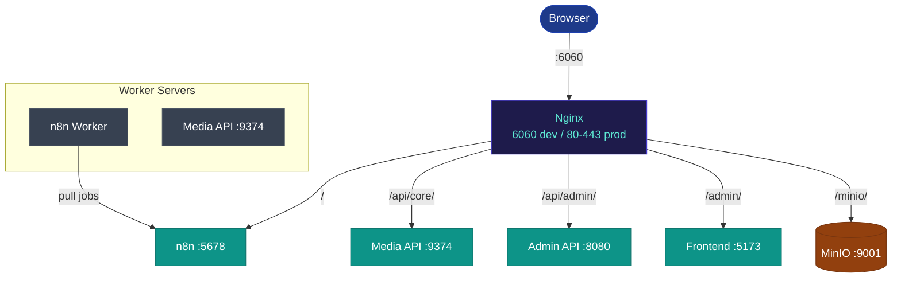
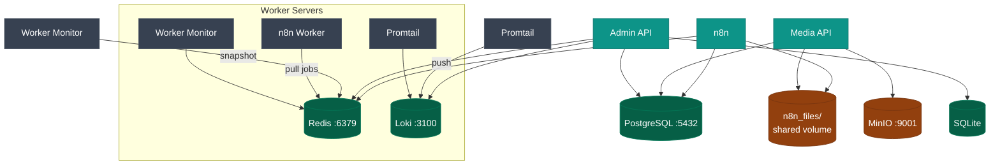

Full component map showing every inter-service connection, storage dependency, and network boundary.

**Request routing** — how traffic flows from browser to service:

**Data dependencies** — which service reads/writes which store:

## Port reference

| Service | Container | Internal port | External path |
|---|---|---|---|
| n8n | `n8n` | 5678 | `/` |
| Media API | `media-api` | 9374 | `/api/core/` |
| Admin API | `admin-api` | 8080 | `/api/admin/` |
| Admin frontend | `frontend` | 5173 (dev) | `/admin/` |
| MinIO console | `minio` | 9001 | `/minio/` |
| PostgreSQL | `postgres` | 5432 | internal only |
| Redis | `redis` | 6379 | internal only |
| Loki | `loki` | 3100 | internal only |
| Nginx | `nginx` | 6060 | exposed to host |

> The `logs-api/` directory contains a standalone FastAPI app but is **not deployed** as a separate container. Log viewing and worker metrics are served by `admin-api` through its own `logs/` module.
