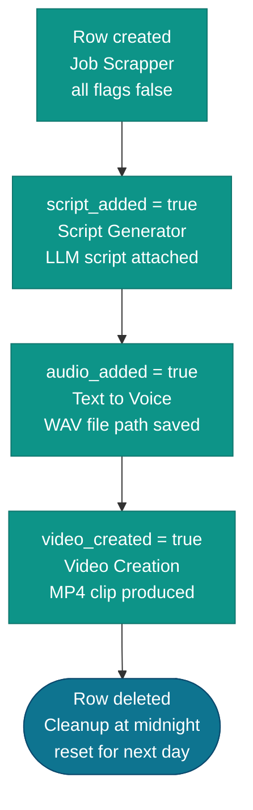

The `job_listing` schema is owned and managed by the Media API (`api/`). Migrations are handled by Alembic.

---

## `job_listing.job_links`

Stores scraped job listings. Populated by the **Job Scrapper** workflow, read and updated by **Script Generator**, marked complete by **Video Creation**.

| Column | Type | Description |
|---|---|---|
| `id` | `INTEGER` PK | Auto-increment primary key |
| `company_name` | `VARCHAR(255)` | Company name |
| `position` | `VARCHAR(255)` | Job title |
| `location` | `VARCHAR(255)` | Job location |
| `date` | `DATE` | Date this row was scraped |
| `experience_required` | `TEXT` | Experience requirements text |
| `skills_required` | `TEXT` | Required skills text |
| `job_type` | `TEXT` | Full-time / part-time / internship |
| `link` | `TEXT` | Original job listing URL |
| `job_description` | `TEXT` | Full job description (added in migration 002) |
| `video_type` | `VARCHAR(50)` | Video style/type used for this listing (added in migration 002) |
| `audio_added` | `BOOLEAN` | Whether TTS audio has been generated |
| `audio_file_name` | `VARCHAR(255)` | Path to the generated audio file |
| `script_added` | `BOOLEAN` | Whether a video script has been generated |
| `script` | `TEXT` | The generated video script |
| `video_created` | `BOOLEAN` | Whether the final MP4 has been created |

### Lifecycle

Each row moves through stages as the pipeline progresses:

The **Cleanup & Reset Database** workflow (runs at midnight) deletes all rows to reset for the next day's run.

---

## `job_listing.mp4_list`

Tracks each pipeline run. One row is inserted per execution of the Youtube Video Upload pipeline.

| Column | Type | Description |
|---|---|---|
| `id` | `INTEGER` PK | Auto-increment primary key |
| `date` | `DATE` | Run date |
| `epoch` | `BIGINT` | Unix timestamp used as the unique run ID; also the folder name under `n8n_files/` |
| `pages_scrapped` | `BIGINT` | Number of search result pages scraped per source |
| `start_time` | `TIME` | Pipeline start time |
| `end_time` | `TIME` | Pipeline end time (null until complete) |
| `mp4_name` | `VARCHAR(255)` | Output video filename |
| `mp4_path` | `TEXT` | Full path to the final combined MP4 |
| `execution_id` | `INTEGER` | n8n execution ID that produced this video |
| `status` | `VARCHAR(50)` | `pending` → `running` → `completed` / `failed` |
| `job_id` | `INTEGER` | FK reference to `job_links.id` |
| `num_of_jobs` | `INTEGER` | Number of jobs processed in this run |
| `video_type` | `VARCHAR(50)` | Video style used for this run |

---

## Alembic migration history

| Revision | Description |
|---|---|
| `001` | Initial schema — creates `job_listing` schema, `job_links` and `mp4_list` tables |
| `002` | Adds `job_description` and `video_type` columns to `job_links` |

See [Alembic Migrations](/docs/database/migrations/) for how to run, generate, and roll back migrations.
