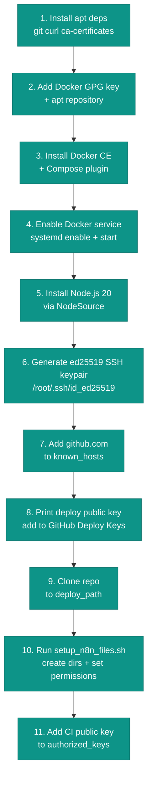

Ansible playbooks live in `ansible/playbooks/`. You can run them locally (requires Ansible installed and SSH key at `~/.ssh/id_ed25519`) or via GitHub Actions (or the optional Bitbucket Pipelines alternative).

---

## `setup.yml` — First-time provisioning

Runs against all servers in the inventory. Every task is idempotent — safe to re-run.



**Variables used:**

| Variable          | Description                                                                                |
| ----------------- | ------------------------------------------------------------------------------------------ |
| `deploy_path`     | From `group_vars/all.yml`, read from the `DEPLOY_PATH` env var                             |
| `deploy_branch`   | Git branch to clone, from the `GIT_BRANCH` env var (default `main`)                        |
| `deploy_key_path` | SSH key path on the server (`/root/.ssh/id_ed25519`), from inventory                       |
| `GITHUB_REPO`     | Env var for the repo slug (`owner/repo`), used to build the `git@github.com:...` clone URL |
| `CI_SSH_PUBKEY`   | Env var containing the CI/local machine's public key                                       |

**After running:** Copy the printed deploy public key and add it to **GitHub → Repository settings → Deploy keys** (read-only access is sufficient).

---

## `deploy_main.yml` — Deploy main server

Targets the `main` inventory group. Imports `tasks/common_setup.yml` first (see below), then runs in one of three modes:

### Mode 1: Full deploy (`full_deploy=true`, `services=""`)

```
1. Pull latest Docker images
   (n8n, nginx, postgres, redis, minio, loki, promtail — admin-api/frontend/fastapi/docs
   are built locally, not pulled)
2. docker compose down  (also clears loki-data/)
3. docker compose up --build -d  (async, 600s timeout)
4. Wait loop: poll every 5s for up to 300s until all containers are running
5. docker compose ps  (print final status)
6. Run Alembic migrations on the fastapi (media-api) service:
   - If tables exist outside Alembic: auto-stamp head then upgrade
   - Otherwise: alembic upgrade head
7. On any failure: dump docker ps -a and fail with a clear message
```

### Mode 2: Targeted restart (`full_deploy=false`, `services="admin-api frontend"`)

```
docker compose up -d --build --no-deps <services>
```

Only the listed containers are restarted. Faster and avoids taking down n8n.

### Mode 3: Skip (`full_deploy=false`, `services=""`)

```
Print "No relevant changes" — nothing is restarted.
```

Used when only `n8n-workflows/` changed.

---

## `deploy_workers.yml` — Deploy worker servers

Targets the `workers` inventory group. Same structure as `deploy_main.yml` but:
- Only pulls `n8n` and `promtail` Docker images (workers don't run postgres/redis/etc.)
- No database migration step
- Uses `worker_services` var instead of `services` for targeted restarts

---

## `rollback.yml` — Rollback

Targets all servers.

```
1. git reset --hard HEAD~1  (revert to previous commit)
2. docker compose up --build -d  (restart with old code)
```

> This permanently moves `HEAD` back one commit on the server. To recover, push a new commit (or force-push from the pipeline). Use with care on shared servers.

---

## `tasks/common_setup.yml` — Shared pre-deploy tasks

Imported at the start of both deploy playbooks:

1. Add `github.com` to `known_hosts` (idempotent — uses the `known_hosts` module)
2. Test SSH connectivity to GitHub
3. `git fetch origin <deploy_branch>`
4. `git checkout -B <deploy_branch> FETCH_HEAD` (server ends up exactly matching that branch)
5. Copy the `.env` file generated by the CI run (from `$PWD/.env` on the runner) to `{{ deploy_path }}/.env`
6. Append static config values (from `group_vars/all.yml`) into `.env` via a marked `blockinfile` block
7. Strip Windows line endings from `.env`
8. Validate every var marked `# REQUIRED` in `.env.example` is actually set in `.env` — aborts the deploy if any are missing
9. `npm install`
10. Run `setup_n8n_files.sh` to ensure directories exist and have correct permissions

---

## Running playbooks locally

```bash
# Requires Ansible installed and SSH key at ~/.ssh/id_ed25519

# Single server full deploy
npm run ansible:deploy:single

# Multi-server full deploy (generates worker inventory first)
CONTABO_WORKER_IP="1.2.3.4,5.6.7.8" npm run ansible:deploy:multi

# Rollback (reverts to previous git commit on all servers)
npm run ansible:rollback:single
CONTABO_WORKER_IP="1.2.3.4,5.6.7.8" npm run ansible:rollback:multi
```
