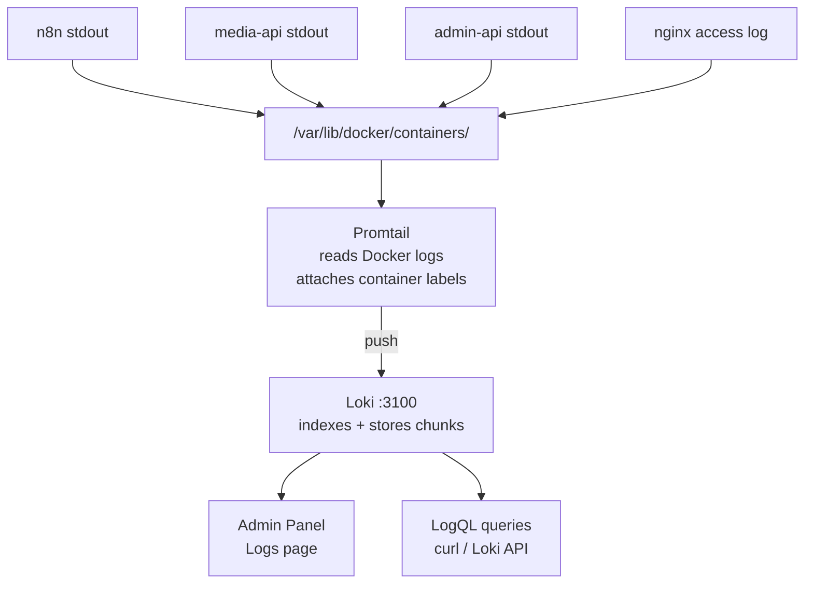

The stack ships with **Promtail + Loki** for log aggregation. Promtail reads every container's stdout/stderr from the Docker socket and ships it to Loki. Logs are then queryable from the [Admin Panel → Logs page](/docs/admin-panel/logs/) or directly via the Loki HTTP API.

## Architecture



Promtail auto-discovers containers via the Docker socket. Each log line is labelled with `container_name`, `compose_service`, and `filename`.

---

## Admin Panel Logs

The fastest way to view logs. Go to **Admin Panel → Logs** and select a container from the dropdown. Supports:
- **Search** — plain text filter applied client-side on the displayed lines
- **Log level filter** — filter by ERROR, WARN, INFO
- **Auto-scroll** — tails the live log stream

See [Admin Panel → Logs page docs](/docs/admin-panel/logs/) for full usage.

---

## Direct Loki queries (LogQL)

Loki is exposed on port `3100` inside the Docker network. From the host:

```bash
# Check Loki is ready
curl http://localhost:3100/ready

# Tail all n8n logs (last 100 lines)
curl -G "http://localhost:3100/loki/api/v1/query_range" \
  --data-urlencode 'query={container_name="n8n"}' \
  --data-urlencode 'limit=100' \
  --data-urlencode "start=$(date -v-1H +%s)000000000" \
  --data-urlencode "end=$(date +%s)000000000"
```

LogQL syntax is similar to PromQL. The key primitives:

```logql
# All logs from a container
{container_name="n8n"}

# Filter to lines containing a string
{container_name="n8n"} |= "error"

# Regex filter
{container_name="media-api"} |~ "job_id=.* status=completed"

# Exclude lines matching a pattern
{container_name="nginx"} != "/api/core/health"

# Parse JSON log lines and filter on a field
{container_name="admin-api"} | json | level="ERROR"

# Count error lines per minute
count_over_time({container_name="n8n"} |= "error" [1m])
```

---

## Useful queries

### n8n — workflow execution errors

```logql
{container_name="n8n"} |= "ERROR" |= "execution"
```

### n8n — specific workflow by name

```logql
{container_name="n8n"} |= "Youtube Video Upload"
```

### Media API — TTS job completions

```logql
{container_name="media-api"} |= "vtt-status" |= "completed"
```

### Media API — slow requests (over 10s)

```logql
{container_name="media-api"} | json | duration > 10
```

### Nginx — 5xx errors

```logql
{container_name="nginx"} |~ "\" 5[0-9]{2} "
```

### Nginx — all requests to /workflow-api/ (docs canvas fetches)

```logql
{container_name="nginx"} |= "/workflow-api/"
```

### Admin API — failed login attempts

```logql
{container_name="admin-api"} |= "401" |= "login"
```

### All containers — last 15 minutes of errors

```logql
{job="docker"} |= "ERROR" | json
```

### Promtail — check it is shipping logs

```logql
{container_name="promtail"} |= "sent"
```

---

## What each container logs

| Container | Log format | Key things to watch |
|---|---|---|
| `n8n` | Mixed text/JSON | Execution errors, credential failures, DB connection issues, worker queue problems |
| `n8n-worker` | Mixed text/JSON | Job pickup errors, execution failures, stalled job warnings |
| `media-api` | JSON (uvicorn + FastAPI) | TTS/video job status, API key rejections (401), slow endpoints, Alembic migration output on startup |
| `admin-api` | JSON (uvicorn + FastAPI) | Auth failures, env var changes, n8n API proxy errors |
| `nginx` | Combined access log | 502/503 errors (backend down), high request rates, suspicious IPs |
| `worker-monitor` | Plain text | CPU snapshots, Redis write failures, Docker API errors |
| `postgres` | Plain text | Slow queries, connection limit warnings, autovacuum activity |
| `redis` | Plain text | Memory warnings (`maxmemory`), connection errors |
| `loki` | JSON | Chunk write errors, WAL issues (if disk is full) |
| `promtail` | JSON | Shipping errors (if Loki is down), file read permission issues |

---

## Log retention

Loki stores chunks in `loki-data/`. There is no automatic pruning configured by default — the directory grows over time.

**To set a retention period**, add to `loki-config.yaml`:

```yaml
limits_config:
  retention_period: 720h   # 30 days
```

Then restart Loki: `docker restart loki`.

**To check current storage usage:**
```bash
du -sh /path/to/project/loki-data/
```

If Loki's storage grows too large and disk fills up, see [Incident Runbook → Disk full](/docs/deployment/runbook/#disk-full).

---

## Promtail config

Promtail is configured at `promtail-config.yaml`. It reads all Docker container logs and auto-labels them with the container name and compose service. No changes are needed unless you want to add custom pipeline stages (e.g. parsing JSON fields, dropping noisy lines).

To drop health-check noise from nginx logs:

```yaml
pipeline_stages:
  - drop:
      expression: ".*/api/core/health.*"
```

After changing the config, restart Promtail: `docker restart promtail`.
