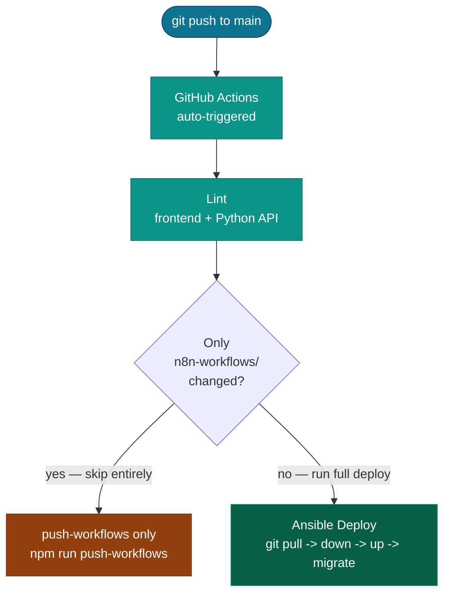

All deployments go through **GitHub Actions + Ansible** (a Bitbucket Pipelines alternative is
also available, see [Bitbucket Pipelines](/docs/deployment/bitbucket-pipelines/)). The pipeline
SSHs into the server(s), pulls the latest code, and restarts the affected Docker containers. No
manual SSH is required for day-to-day deploys.

## How a typical deploy works



## Three ways to deploy

| Method                                                                 | When to use                                           |
| ---------------------------------------------------------------------- | ----------------------------------------------------- |
| Push to `main`                                                         | Normal code changes — auto-triggers the full pipeline |
| GitHub Actions manual dispatch (`workflow_dispatch`, `services` input) | Restart specific containers without a full deploy     |
| `npm run ansible:deploy:single` (local)                                | Emergency manual deploy from your machine             |

## What gets deployed where

| Topology      | Main server                                                                                   | Worker servers                                |
| ------------- | --------------------------------------------------------------------------------------------- | --------------------------------------------- |
| Single server | Everything                                                                                    | —                                             |
| Multi-server  | n8n, worker-monitor, redis, postgres, nginx, rustfs, admin-api, frontend, docs, loki, promtail | n8n-worker, worker-monitor, fastapi, promtail |

Topology is controlled by the `CONTABO_WORKER_IP` variable — see [Topology](/docs/deployment/topology/).

## Environment variable changes

Do **not** edit `.env` on the server directly. Use the [Admin Panel → Settings → Environment tab](/docs/admin-panel/settings/). Saving through the admin panel writes `.env` and optionally syncs to GitHub Secrets.

If you must change a variable manually:
```bash
ssh root@<server-ip>
nano $DEPLOY_PATH/.env
docker restart <container-name>
```

## Further reading

- [Topology](/docs/deployment/topology/) — switching between single and multi-server
- [GitHub Actions Pipeline](/docs/deployment/github-pipeline/) — what each pipeline step does
- [Bitbucket Pipelines](/docs/deployment/bitbucket-pipelines/) — the optional alternate CI
- [Ansible Playbooks](/docs/deployment/ansible-playbooks/) — step-by-step breakdown
- [Manual Operations](/docs/deployment/manual-ops/) — SSH shortcuts, targeted restarts, rollbacks
