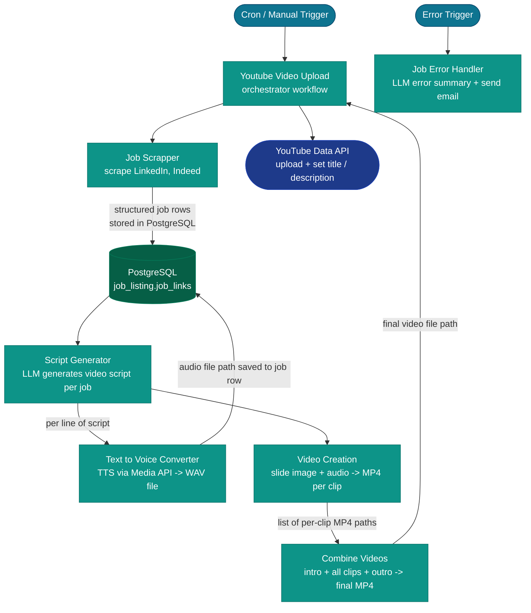

The Youtube Stream (JNN) folder contains the core product: an automated pipeline that scrapes job listings daily, generates AI video scripts, converts them to speech, builds MP4 slides, and uploads the final video to YouTube.

## Pipeline flow

---

## Workflow details

### Youtube Video Upload

**ID:** `qdTPjAJEFePSZNC5` | **Trigger:** Scheduled (or manual)

The top-level orchestrator. Starts the full pipeline end-to-end, looping over all job listings for the day. Each iteration calls Job Scrapper, Script Generator, Video Creation, and Combine Videos as sub-workflows, then uploads the final MP4 to YouTube.

**Credentials used:** YouTube OAuth2 API, PostgreSQL, FastAPI Server (via RemoteExecute)

---

### Job Scrapper

**ID:** `2Kbv7D61qx6QiovN` | **Trigger:** Called by Youtube Video Upload

Scrapes job listings from LinkedIn and Indeed via the Media API's **JobSpy-based job scraper** (`POST /job-scrape/linkedin`, `POST /job-scrape/indeed`, polled to completion). Uses an OpenAI LLM (via LangChain) to extract structured job data (title, company, description, skills) from the scraped results. Stores results in PostgreSQL `job_listing.job_links`.

Tracks pages scraped per source in n8n Data Tables globals to avoid duplicates across runs.

**Credentials used:** FastAPI Server (Media API), OpenAI, PostgreSQL  
**See:** [Job Scraper (JobSpy)](/docs/credentials/job-scraper/), [Media API → Job Scraper](/docs/services/media-api/#job-scraper)

---

### Script Generator

**ID:** `3CV8vOr3daIHXK6X` | **Trigger:** Called by Youtube Video Upload

For each job row from PostgreSQL, generates a video script using an OpenAI LLM chain. Splits the script into individual lines, then calls **Text to Voice Converter** for each line. Saves generated audio file paths back to the PostgreSQL row (`audio_added = true`, `audio_file_name`).

**Credentials used:** OpenAI, PostgreSQL, Text to Voice Converter (sub-workflow call)

---

### Text to Voice Converter

**ID:** `7Nx6lwYZ4Vb8vD8v` | **Trigger:** Called by Script Generator

Sub-workflow. Takes a text string and:
1. Calls `POST /api/core/vtt-generate-audio-bytes` on the Media API.
2. Polls `GET /api/core/vtt-status/{job_id}` every 10 seconds.
3. Downloads the WAV from `GET /api/core/vtt-result/{job_id}` when complete.
4. Returns the audio file path.

**Credentials used:** FastAPI Server (Media API)

---

### Video Creation

**ID:** `HmMxxv4eZOZGzrOl` | **Trigger:** Called by Youtube Video Upload

For each script line:
1. Fetches job-specific slide images (PPT → images via `POST /extract-slides`).
2. Combines each image + audio file into an MP4 (`POST /convert-to-mp4`).
3. Polls status until complete.
4. Uses the **RemoteExecute** custom node for file management operations (copying files between directories, etc.).

Returns a list of per-clip MP4 paths to the orchestrator.

**Credentials used:** FastAPI Server (Media API), RemoteExecute custom node

---

### Combine Videos

**ID:** `66MHT0z3zhiYgblm` | **Trigger:** Called by Youtube Video Upload

Takes a list of MP4 files:
1. Prepends an intro video and appends an outro.
2. Re-encodes each clip to a consistent format/bitrate with `POST /convert-mp4-to-mp4`.
3. Calls `POST /combine-videos` to concatenate them all into the final video.
4. Polls `/combine-videos-status/{job_id}` until complete.
5. Returns the final video path.

**Credentials used:** FastAPI Server (Media API)

---

### Job Video Error Handling

**ID:** `3LEV6jB7r0TQcMN6` | **Trigger:** Error trigger (fires when any workflow in the pipeline fails)

1. Uses an OpenAI LLM to generate a human-readable error summary.
2. Sends the summary via SMTP email.
3. Marks the failed job's status as `failed` in PostgreSQL.

**Credentials used:** OpenAI, SMTP, PostgreSQL

---

### Cleanup & Reset Database

**ID:** `cls465MeDCQ5kLdb` | **Trigger:** Scheduled (midnight) or manual

Runs at the end of each day to reset for the next run:
1. Deletes all rows from `job_listing.job_links` and `job_listing.mp4_list`.
2. Uses **RemoteExecute** to delete files from `n8n_files/audio_files/`, `n8n_files/video_files/`, etc.

**Credentials used:** PostgreSQL, RemoteExecute custom node

---

### Scheduler for Youtube Video

**ID:** `kWYlADplv47HnBgb` | **Active:** no | **Trigger:** Schedule (4 cron slots)

An alternative trigger for the JNN pipeline. Instead of running the full pipeline directly, it checks whether the server has enough CPU headroom before starting, preventing a new run from overloading a machine that is already busy.

**What it does:**
1. Reads global config from the **Get Global Data in JSON Format From Data Tables** sub-workflow.
2. Calls `GET /cpu-gate` on the Media API — this endpoint returns whether CPU load is below the configured threshold.
3. If the CPU gate passes: publishes a job to the Redis key `jnn:job:queue` to trigger the pipeline.
4. If the CPU gate fails: waits 1 minute and exits (will retry on the next cron slot).

Currently disabled because the schedule and CPU gate logic is handled inside the **Youtube Video Upload** orchestrator directly.

**Credentials used:** FastAPI Server (Media API), Redis (via n8n Redis node)

---

### Video Report Creator

**ID:** `13nsrEpCAcELKNMA` | **Active:** no | **Trigger:** Schedule (18:30 daily) + manual

Generates a daily summary report of the pipeline run and emails it. Reads execution data from the n8n API rather than PostgreSQL, so it gives a workflow-level view of what succeeded and failed.

**What it does:**
1. Reads all MP4 files produced today from the `job_listing.mp4_list` PostgreSQL table.
2. Calls the **n8n REST API** (`GET /api/v1/executions`) to retrieve execution records for today's runs.
3. Extracts execution status, duration, and error messages from the API response.
4. Passes the combined data to an **OpenAI LLM chain** (GPT-4.1 nano) that generates a human-readable HTML report summarising: videos produced, success rate, errors encountered, and total runtime.
5. Parses the structured output via a JSON output parser.
6. Sends the HTML report as an email via SMTP.

**Credentials used:** PostgreSQL, n8n API (internal), OpenAI, SMTP

---

### Instagram Video Upload

**ID:** `h1kQfLNxCB994HE2` | **Active:** no | **Trigger:** Schedule (4 cron slots at :00/:15/:30/:45) + manual

A parallel video pipeline for Instagram Reels — nearly identical to the YouTube pipeline but with a different publish step. It reuses all the same JNN sub-workflows (Job Scrapper, Script Generator, Video Creation, Combine Videos) and adds Instagram-specific logic.

**What it does:**
1. Reads global config from **Get Global Data in JSON Format From Data Tables**.
2. Gets the current epoch from PostgreSQL to scope today's job listings.
3. Checks whether a video is already pending to avoid duplicate runs.
4. Calls **Job Scrapper** to scrape and store job listings.
5. Calls **Script Generator** to generate scripts.
6. Calls **Video Creation** to produce per-clip MP4s.
7. Combines clips into a final video using **Combine Videos** — called up to 3 times for intro, body, and outro segments.
8. Generates a UUID for the video filename, saves the output path to PostgreSQL.
9. Reads the final video file and publishes to Instagram via the Instagram node (currently disabled on the node itself).
10. On error: updates the video row in PostgreSQL with a failed status.

**Credentials used:** PostgreSQL, FastAPI Server (Media API), OpenAI, Instagram (disabled)

---

## Database state through the pipeline

Each job row in `job_listing.job_links` moves through stages as the pipeline runs:

| Stage | Column | Value |
|---|---|---|
| Scraped | (row created) | all flags false |
| Script ready | `script_added` | `true` |
| Audio ready | `audio_added` | `true` |
| Video ready | `video_created` | `true` |

The **Cleanup workflow** deletes all rows at midnight to reset for the next day's run.

See [job_listing schema](/docs/database/job-listing-schema/) for full column reference.
