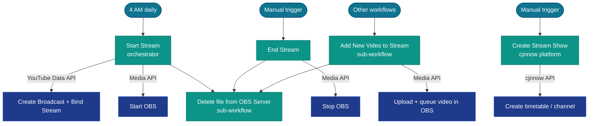

A set of workflows that automate a YouTube live streaming operation. Every morning at 4 AM a stream is created on YouTube and started in OBS. Videos are queued into the stream throughout the day, then OBS is stopped manually when done. A separate "Create Stream Show" workflow manages content scheduling on the **cjnnow** broadcast platform.

## System architecture

---

## Workflow details

### Start Stream

**ID:** `5b7h0jDyoclJWReh` | **Trigger:** Schedule (4 AM daily) + manual

The daily orchestrator that sets up the entire live stream from scratch each morning.

**What it does:**
1. Reads global workflow variables (stream key, channel ID, etc.) from a `CUSTOM.WorkflowVariables` node.
2. Calls the **YouTube Data API** via HTTP to list existing live streams for the channel.
3. If a stream already exists for today: reuses it. If not: creates a new live stream resource.
4. Creates a YouTube **broadcast** (the public-facing video) and binds it to the stream using the YouTube Data API.
5. Sends a start command to **OBS** via the Media API to begin broadcasting.
6. Queries PostgreSQL for video files older than 2 days and calls the **Delete file from OBS Server** sub-workflow to clean them up.
7. Saves the new stream and broadcast IDs back to global variables for other workflows to reference.

**Credentials used:** YouTube Data API (HTTP), FastAPI Server (Media API), PostgreSQL

---

### End Stream

**ID:** `At21dbX6Z2zNsJbp` | **Trigger:** Manual

Cleanly shuts down the live stream when broadcasting is done for the day.

**What it does:**
1. Reads global workflow variables to retrieve the active stream session info.
2. Sends a stop command to **OBS** via the Media API.
3. Queries PostgreSQL for video files older than 2 days and calls the **Delete file from OBS Server** sub-workflow to free up disk space.

**Credentials used:** FastAPI Server (Media API), PostgreSQL

---

### Add New Video to Stream

**ID:** `ZyRPbgnaKH8JFLLP` | **Trigger:** Called by other workflows (active)

Sub-workflow. Takes a local MP4 file and adds it to the OBS streaming queue.

**What it does:**
1. Reads global workflow variables for the OBS server endpoint.
2. Uploads the MP4 file to the OBS server via a `POST` request to the Media API file upload endpoint.
3. Waits 10 seconds, then polls the upload status endpoint.
4. On success: sends the video to the OBS streaming queue via the Media API.
5. On failure: stops the workflow with an error.

**Credentials used:** FastAPI Server (Media API)

---

### Delete file from OBS Server

**ID:** `iQh3Pg7VqAQ6YKGi` | **Trigger:** Called by Start Stream and End Stream (active)

Sub-workflow. Deletes a file from the OBS server and confirms deletion.

**What it does:**
1. Reads global workflow variables for the OBS server endpoint.
2. Sends a `DELETE` request for the specified file to the Media API.
3. Waits 2 seconds, then polls the deletion status endpoint.
4. On success: returns the result to the caller.
5. On failure: stops the workflow with an error.

**Credentials used:** FastAPI Server (Media API)

---

### Create Stream Show

**ID:** `cn9gyNxryLOBBhps` | **Trigger:** Manual

Creates a scheduled content block on the **cjnnow** broadcast platform. This workflow is separate from OBS/YouTube and manages the content timetable on a third-party broadcast scheduling API.

**What it does:**
1. Fetches the full asset library from the cjnnow API (videos, images, segments).
2. Checks whether a show already exists for the target time slot.
3. Gets the duration of each available asset.
4. Randomly selects `n` assets from the library to fill the show slot.
5. Creates a new channel or timetable entry on cjnnow with those assets.
6. Sets each selected asset for the show via the cjnnow API.

**Credentials used:** cjnnow API (HTTP requests with API key)

---

### Text to Voice Converter (Streaming)

**ID:** `haVleCvRojSl2XJ3` | **Trigger:** Called by Play Medicine Reminder (active)

A sub-workflow that converts text to speech audio — functionally identical to the JNN pipeline's [Text to Voice Converter](/docs/n8n-workflows/jnn-pipeline/#text-to-voice-converter) (`7Nx6lwYZ4Vb8vD8v`) but deployed as a separate workflow instance used by the medicine reminder system.

**What it does:**
1. Reads global config from n8n Data Tables (Media API endpoint, auth key).
2. Sends `POST /api/core/vtt-generate-audio-bytes` to the Media API with the input text.
3. Waits 10 seconds, then polls `GET /api/core/vtt-status/{job_id}`.
4. Once complete, downloads the audio file from `GET /api/core/vtt-result/{job_id}`.
5. Returns the audio file path to the caller.

**Credentials used:** FastAPI Server (Media API)
