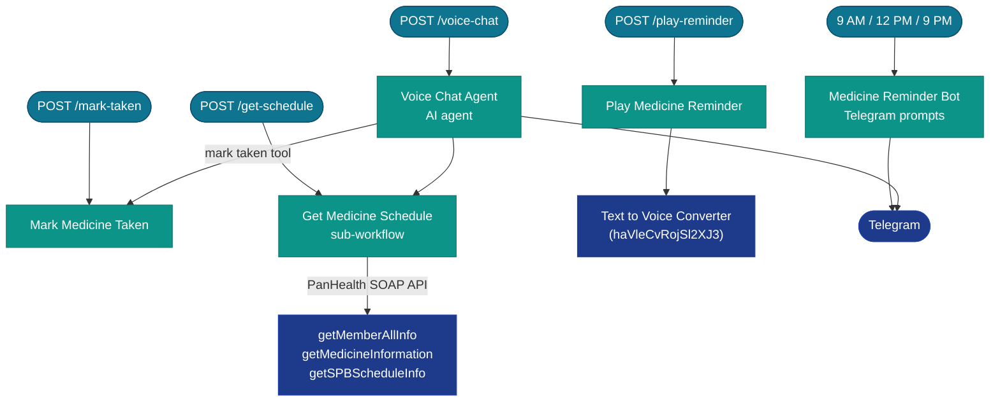

A personal healthcare reminder system called **PanMom**. It fetches a patient's medicine schedule from a hospital SOAP API (PanHealth), plays audio reminders via TTS at scheduled times, and provides a Telegram bot and an AI voice chat agent so the patient can interact with their schedule naturally.

## System architecture

---

## Workflow details

### Medicine Reminder Bot

**ID:** `l4PlSiGrMmW6cYY7` | **Trigger:** Cron (9 AM, 12 PM, 9 PM) + Telegram message

An older standalone prototype that sends proactive Telegram reminders at three fixed times daily and follows up if the patient does not respond.

**What it does:**
1. Fires at 9 AM, 12 PM, and 9 PM via cron, or when a Telegram message arrives.
2. Sends a Telegram message asking if the patient has taken their medicine.
3. Waits for a response and checks it:
   - **Taken:** sends a confirmation message.
   - **Skip / no response after 30 min:** sends another reminder and asks what time they want to be reminded again.
4. Reschedules the reminder based on the patient's reply.

This workflow does **not** call the PanHealth SOAP API — it is a simple hardcoded reminder prototype. The more advanced system uses the webhook-based workflows below.

**Credentials used:** Telegram API

---

### Get Medicine Schedule

**ID:** `Pj9nwwSVoIoxPElb` | **Trigger:** Called by Voice Chat Agent + webhook (POST `/get-schedule`)

Sub-workflow and webhook endpoint. Fetches a patient's full medicine schedule from the **PanHealth** hospital SOAP API and returns it in a structured format.

**What it does:**
1. Accepts a `member_id` from the caller.
2. Calls `getMemberAllInfo` on the PanHealth SOAP API to get patient details.
3. Calls `getMedicineInformation` to retrieve the patient's full medicine list.
4. Calls `getSPBScheduleInfo` to get the dispensing schedule (which medicine at what time).
5. Parses the SOAP XML responses into clean JSON.
6. Groups medicines by time slot (morning, noon, evening).
7. Returns the structured schedule to the caller (or responds to the webhook directly).

**Credentials used:** PanHealth SOAP API (HTTP requests with auth headers)

---

### Play Medicine Reminder

**ID:** `FxdGFW3IBnSRPC1q` | **Trigger:** Webhook (POST `/play-reminder`, active)

Receives a reminder trigger and plays the medicine name and dosage as a spoken audio reminder via TTS.

**What it does:**
1. Receives the medicine name and reminder text in the webhook payload.
2. Builds the TTS text (e.g. "Time to take Metformin 500mg").
3. Calls the **Text to Voice Converter** sub-workflow (`haVleCvRojSl2XJ3`) to generate an audio file.
4. The audio file is played on the target device (the Media API handles device playback).

**Credentials used:** FastAPI Server (Media API, via Text to Voice Converter sub-workflow)

---

### Mark Medicine Taken

**ID:** `BhvmrZvggoiHWG0p` | **Trigger:** Webhook (POST `/mark-taken`)

Records that a patient has taken a specific medicine. Called by the Voice Chat Agent when the patient says they took their medicine.

**What it does:**
1. Receives `member_id`, `medicine_name`, and `taken_at` timestamp in the webhook payload.
2. Logs the taken event (currently logs to console — persistence layer to be wired up).
3. Responds to the webhook with a confirmation.

**Credentials used:** none (HTTP webhook only)

---

### Voice Chat Agent

**ID:** `UvhkwIqCXgv6abtN` | **Trigger:** Webhook (POST `/voice-chat`) + n8n chat

An AI agent (GPT-4.1 nano (OpenAI API)) that lets the patient interact with their medicine schedule through natural language — either via a webhook (for voice input piped in from a voice interface) or through the n8n chat UI.

**What it does:**
1. Receives the patient's text or voice-transcribed message.
2. Routes it to an AI agent with window buffer memory (remembers recent conversation turns).
3. The agent has two tools:
   - **Mark Taken Tool** — calls `POST /webhook/mark-taken` to record that a medicine was taken.
   - **Get Schedule Tool** — calls the Get Medicine Schedule sub-workflow to fetch today's schedule from PanHealth.
   - **Snooze Reminder Tool** — stub (not yet implemented).
4. The agent formulates a natural language reply and responds to the webhook or chat.

**Example interactions:**
- "I just took my morning medicine" → agent calls Mark Taken
- "What do I need to take at noon?" → agent calls Get Schedule and summarises
- "Remind me again in 30 minutes" → agent calls Snooze (stub)

**Credentials used:** OpenAI (GPT-4.1 nano), FastAPI Server (via HTTP tool calls)

---

### panmom (Webhook Orchestrator)

**ID:** `98rN1IU4YbNVeUGX` | **Trigger:** Webhook (two endpoints)

An earlier, more monolithic webhook handler for the PanMom system. It fetches a full medicine schedule from PanHealth SOAP APIs, parses the dispensing times, and builds a schedule — similar to Get Medicine Schedule but implemented as a single large workflow rather than a sub-workflow.

**What it does:**
1. Receives a request on one of two webhook endpoints.
2. Calls `getMemberAllInfo`, `getMedicineInformation`, and `getSPBScheduleInfo` on the PanHealth SOAP API.
3. Parses the SPB schedule into time slots.
4. Groups medicines into a schedule by time of day using a code node.
5. Uses a code node to build a hardcoded schedule format for the MVP.
6. Responds to the webhook with the schedule JSON.

This workflow predates the modular Get Medicine Schedule + Voice Chat Agent design. Both exist in the system; the newer sub-workflow approach is preferred.

**Credentials used:** PanHealth SOAP API (HTTP requests)
