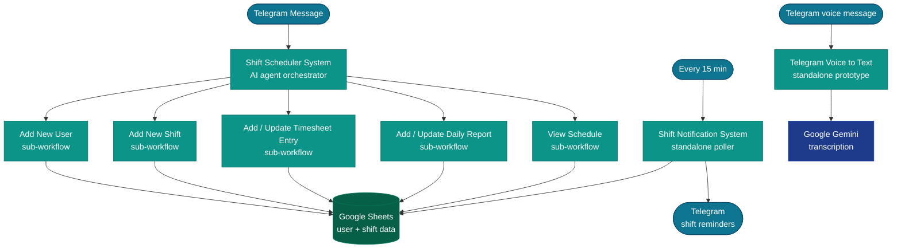

A complete shift scheduling and timesheet system built on **Google Sheets** (as the database) and **Telegram** (as the user interface). All data — users, shifts, timesheets, daily reports — lives in Google Sheets. Staff interact entirely through the Telegram bot.

These workflows are currently **inactive** (deployed but not running). The system is built and ready — it just needs credentials configured and workflows toggled on.

## System architecture

---

## Workflow details

### Shift Scheduler System

**ID:** `0Btpj3XL2SbiOFK7` | **Trigger:** Telegram message or n8n chat

The main orchestrator and user-facing entry point. It is an **AI agent** (ChatGPT (OpenAI)) that understands natural language commands sent by managers via Telegram. The agent decides which sub-workflow to call based on the intent of the message.

**What it does:**
1. Receives a Telegram message or chat input.
2. Routes it through a Switch node — distinguishing commands (add user, add shift, view schedule, etc.) from conversational messages.
3. Calls the appropriate sub-workflow as an agent tool: Add New User, Add New Shift, Add / Update Timesheet Entry, Add / Update Daily Report, or View Schedule.
4. Reads and updates a user database in Google Sheets via agent tools.
5. Sends the response back to the Telegram chat.

The agent has access to a "Conversational Message Handler" tool for free-form chat and a "Retrieve User Information" tool that queries Google Sheets to look up employees.

**Credentials used:** Telegram API, Google Sheets, OpenAI API

---

### Shift Notification System

**ID:** `6ZFmKRv0H95RWU48` | **Trigger:** Schedule (every 15 minutes)

A standalone polling workflow that sends proactive shift reminders to employees via Telegram without any user input. It runs every 15 minutes and checks whether any shifts are starting or ending soon.

**What it does:**
1. Reads all user records and their timezone from Google Sheets.
2. For each user, checks today's shift details and whether it is a working day.
3. Calculates the time difference to the shift start and end times.
4. If a shift is starting or ending within the notification window, sends a Telegram message to the employee.
5. If a shift has ended and no timesheet entry was recorded, sends a prompt asking the employee to log their hours.
6. Updates a "question summary" column in Google Sheets to track what was last asked.

**Credentials used:** Telegram API, Google Sheets

---

### Add / Update Timesheet Entry

**ID:** `Cl83jXD14v6alJjm` | **Trigger:** Called by Shift Scheduler System

Sub-workflow. Records an employee's clock-in or clock-out time for a shift.

**What it does:**
1. Receives `user_id`, `entry_type` (start or end), and timestamp from the caller.
2. Switches on `entry_type`:
   - **Start:** writes the start time to the Google Sheets timesheet row for that day.
   - **End:** writes the end time and calculates total hours worked.
3. Updates the "latest question summary" column so the notification system knows where the conversation left off.

**Credentials used:** Google Sheets

---

### Telegram (Voice to Text)

**ID:** `GJbzVQ49qGz8vZv4` | **Trigger:** Telegram voice message

A standalone prototype that transcribes Telegram voice messages using **Google Gemini**. It is not wired into the main Shift Scheduler agent — it operates as an independent bot that responds to any voice message sent to the Telegram bot.

**What it does:**
1. Receives a voice message update from Telegram.
2. Downloads the voice file from Telegram's servers.
3. Fixes the MIME type (Telegram sends OGG; Gemini expects audio/ogg).
4. Sends the audio to **Google Gemini** (`transcribe a recording` node) for speech-to-text.
5. Extracts the transcribed text from the Gemini response.
6. Sends the transcription back to the user as a Telegram text message.

**Credentials used:** Telegram API, Google Gemini API

---

### Add / Update Daily Report

**ID:** `IMnHHCu7gxSxfeAi` | **Trigger:** Called by Shift Scheduler System

Sub-workflow. Records an employee's start-of-day or end-of-day report text in Google Sheets.

**What it does:**
1. Receives `user_id`, `report_type` (start or end), and the report text from the caller.
2. Switches on `report_type`:
   - **Start:** writes the morning report to the daily report row.
   - **End:** writes the closing report and marks the day complete.
3. Updates the "latest question summary" column so the notification system tracks the conversation state.

**Credentials used:** Google Sheets

---

### Add New Shift

**ID:** `TrlEwaUo64KDpyvU` | **Trigger:** Called by Shift Scheduler System

Sub-workflow. Creates a new shift slot for an employee on a given weekday.

**What it does:**
1. Reads the employee's existing weekly shift list from Google Sheets.
2. Aggregates the list of days already assigned.
3. Checks whether the requested weekday is already in the list to prevent duplicates.
4. If new: calculates the next occurrence of that weekday, appends it to the shift list, and writes the new shift row to Google Sheets.
5. Updates the "latest question summary" to confirm the shift was added.

**Credentials used:** Google Sheets

---

### Add New User

**ID:** `oEPj7KrkxSck6RDI` | **Trigger:** Called by Shift Scheduler System

Sub-workflow. Registers a new employee in the scheduling system.

**What it does:**
1. Looks up the provided user identifier in Google Sheets to check if the employee already exists.
2. If the user exists: returns a message saying so and skips creation.
3. If the user is new:
   - Inserts a new row into the user table with name, Telegram ID, and timezone.
   - Creates an initial empty weekly shift list (using a code node to calculate the next occurrence of each weekday).
   - Writes the initial shift rows to Google Sheets.
4. Updates the question summary to confirm registration.

**Credentials used:** Google Sheets

---

### View Schedule

**ID:** `pzoZqfcxHfTEw2f9` | **Trigger:** Called by Shift Scheduler System

Sub-workflow. Returns a formatted weekly schedule for an employee and sends it directly to Telegram.

**What it does:**
1. Reads the employee's weekly shift rows from Google Sheets using their user ID.
2. Runs a code node to format the shift data into a human-readable schedule string (e.g. "Monday: 09:00 – 17:00, Tuesday: off, …").
3. Sends the formatted schedule as a Telegram message directly from within the sub-workflow.

**Credentials used:** Google Sheets, Telegram API

---

## Activating the system

1. Configure a **Telegram Bot** credential in n8n → Settings → Credentials.
2. Configure a **Google Sheets OAuth2** credential and share the scheduling spreadsheet with the service account.
3. Configure an **OpenAI** credential for the AI agent (Shift Scheduler System).
4. Open each workflow and confirm the correct credentials are selected.
5. Toggle all workflows **Active** in the n8n UI.
6. Run `npm run pull-workflows` to capture the updated active state in git.
