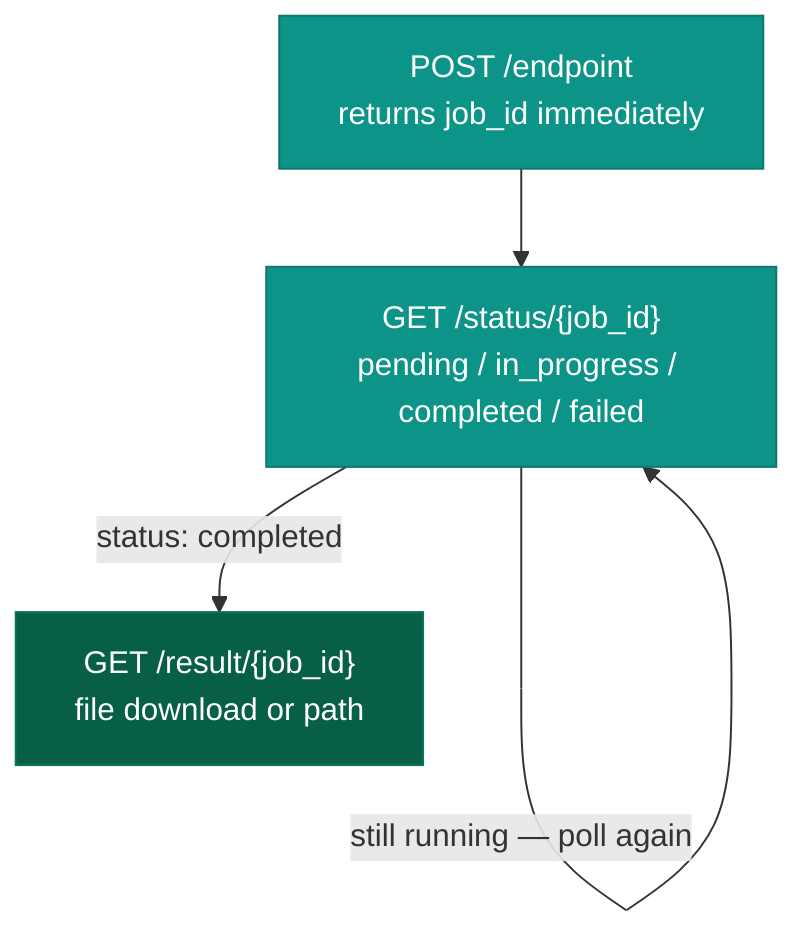

**Base path:** `/api/core`  
**Auth:** `X-API-Key` header (value = `API_KEY` env var) on every endpoint **except** `/health`.  
**Container:** `media-api`  
**Internal port:** `9374`  
**Swagger UI:** `http://localhost:6060/api/core/docs`

Handles all CPU-intensive work called by n8n workflows. All heavy operations are **async** — caller gets a `job_id` immediately, polls status, then retrieves the result.

## Job lifecycle



---

## Text-to-Speech

| Method | Path | Description |
|---|---|---|
| `POST` | `/vtt-generate-audio-bytes` | Start TTS job. Body: `{ text, voice? }`. Returns `{ job_id }`. |
| `GET` | `/vtt-status/{job_id}` | Poll job status. |
| `GET` | `/vtt-result/{job_id}` | Download WAV file when complete. |

TTS results are cached in `tts_cache/` — identical `text + voice` requests skip synthesis and return the cached file instantly.

---

## PowerPoint Processing

| Method | Path | Description |
|---|---|---|
| `POST` | `/ppt-generator` | Fill a PPT template from JSON. Body: `{ template, data }`. Synchronous. |
| `GET` | `/ppt/{file_name}` | Download a generated PPT. |
| `POST` | `/extract-slides` | Extract PPT slides as images (async). Body: `{ file_name }`. |
| `GET` | `/img-ext-status/{job_id}` | Poll extraction status. |
| `GET` | `/img-ext-result/{job_id}` | Get extracted image paths. |

---

## Video Operations

| Method | Path | Description |
|---|---|---|
| `POST` | `/convert-to-mp4` | Image + audio → MP4 (async). Body: `{ image_file, audio_file, epoch, video_type, upload_to_minio? }`. |
| `GET` | `/convert-to-mp4-status/{job_id}` | Poll conversion status. |
| `POST` | `/convert-mp4-to-mp4` | Re-encode existing MP4 to consistent format. Body: `{ file_name }`. Synchronous. |
| `POST` | `/combine-videos` | Concatenate MP4 files (async). Body: `{ video_files[], epoch }`. |
| `GET` | `/combine-videos-status/{job_id}` | Poll combine status. |
| `GET` | `/combine-videos-result/{job_id}` | Download final combined video. |

---

## File Management

| Method | Path | Description |
|---|---|---|
| `POST` | `/cleanup` | Delete contents of `n8n_files/` subdirs. Body: `{ folders[] }`. |
| `POST` | `/copy-video` | Copy a video into its epoch subfolder. |

---

## Execute (shell command relay)

| Method | Path | Description |
|---|---|---|
| `POST` | `/execute` | Run a shell command or inline script on the server. Body: `{ command? }` or `{ script? }`. |

Used by the `RemoteExecute` custom n8n node and the Admin API's container restart and backup features.

### Security model

Two modes:

**Command mode** (`command` field): runs a single command validated by `shlex.split`. The executable must be in `/sh_files/` if it's a path. Wrapper commands (`env`, `xargs`, `find`, etc.) and interpreter `-c` flags are blocked. A regex blocklist rejects recursive deletes, disk writes outside allowed dirs, subshell substitution, download-and-execute, fork bombs, `sudo`, and firewall flush.

**Script mode** (`script` field): writes an inline script to a temp file and runs it as `bash`. Subshell substitution is allowed (needed for normal scripts), but all destructive/privilege-escalation patterns are still blocked.

Return value: `{ output, returnCode }`. Non-zero `returnCode` → HTTP 500.

---

## Job Scraper

Scrapes live job listings directly from LinkedIn and Indeed using [JobSpy](https://github.com/speedyapply/JobSpy) — no external search API or key required.

| Method | Path | Description |
|---|---|---|
| `POST` | `/job-scrape/linkedin` | Start a LinkedIn scrape (async). Body: `{ search_term, location?, batch_size?, start_index?, job_type?, is_remote?, hours_old?, easy_apply?, linkedin_fetch_description?, linkedin_company_ids?, proxies? }`. Returns `{ job_id }`. |
| `POST` | `/job-scrape/indeed` | Start an Indeed scrape (async). Body: `{ search_term, location?, batch_size?, start_index?, distance?, job_type?, is_remote?, hours_old?, easy_apply?, country_indeed?, proxies? }`. Returns `{ job_id }`. |
| `GET` | `/job-scrape-status/{job_id}` | Poll scrape status. |
| `GET` | `/job-scrape-result/{job_id}` | Get the scraped job listings once `status: completed`. |

On LinkedIn, `hours_old` and `easy_apply` are mutually exclusive (`hours_old` wins). On Indeed, priority is `hours_old` > (`job_type`/`is_remote`) > `easy_apply` — lower-priority filters are silently dropped when a higher one is set.

---

## CPU Gate

The CPU gate prevents new heavy jobs from being submitted when the server is already loaded.

| Method | Path | Description |
|---|---|---|
| `GET` | `/cpu-gate` | Current CPU snapshot: `{ cpu_raw, cpu_ema, cpu_effective, threshold, warmed_up, ready }`. |
| `GET` | `/cpu-gate/wait?timeout=300` | Block (poll every 30s) until `cpu_effective < threshold` or timeout (30–1800s). |
| `GET` | `/cpu-gate/reset` | Reset the local EWMA fallback state. |

- `ready: false` means the server is too loaded; workflows should wait before submitting new video/TTS work.
- The gate reads from the worker-monitor Redis snapshot when available; falls back to reading `/proc/stat` directly when Redis is unavailable.

---

## Voice Chat WebSocket

| Method | Path | Description |
|---|---|---|
| `WS` | `/ws/voice-chat?webhook_id=<id>` | Live AI voice conversation over WebSocket. |

Real-time voice AI chat. Binary protocol:

```
Client → server : raw 16 kHz 16-bit mono PCM chunks (~100ms each)
Server → client : WAV audio chunks, one per TTS sentence
```

**Flow per utterance:**
1. Client streams PCM chunks continuously.
2. Server runs **WebRTC VAD** (Voice Activity Detection, aggressiveness=2) on each 30ms frame to detect end-of-speech.
3. Once silence is detected after speech, the complete utterance PCM is passed to **Faster-Whisper** (`base` model) for STT transcription.
4. Transcribed text is POSTed to the n8n webhook at `N8N_WEBHOOK_BASE_URL/<webhook_id>` (default: `voice-chat`).
5. n8n processes it through an LLM and returns `{ response }`.
6. Response is synthesized via **Kokoro TTS** sentence-by-sentence and streamed back as WAV chunks.

One VAD instance per WebSocket connection. The connection is stateful — do not share one WebSocket across users.

**Environment variables:**

| Variable | Default | Description |
|---|---|---|
| `N8N_WEBHOOK_BASE_URL` | `http://n8n:5678/webhook` | Base URL for the n8n webhook |

---

## Utility

| Method | Path | Description |
|---|---|---|
| `GET` | `/health` | Returns `{ status: "ok" }`. No auth required. Used by Docker health checks. |

---

## File volume layout

All files live in the `n8n_files/` Docker volume, shared between `media-api` and `n8n`:

| Subdirectory | Contents |
|---|---|
| `audio_files/` | TTS WAV outputs |
| `video_files/` | MP4 files, organized by epoch |
| `ppt_files/` | Generated PowerPoint files |
| `ppt_images/` | Slide images extracted from PPTs |
| `pdf_files/` | PDF outputs |

---

## Adding a new endpoint

1. Create `api/routers/<name>.py` — extend `APIRouter`, use `BackgroundTasks` for async work.
2. Add to `all_routers` in `api/routers/__init__.py`.
3. Add Pydantic schemas to `api/schemas.py`.
4. If a new async worker class is needed, follow the `set_job_status` / `get_job` pattern in `api/audio_manager/` or `api/video_generator/`.
